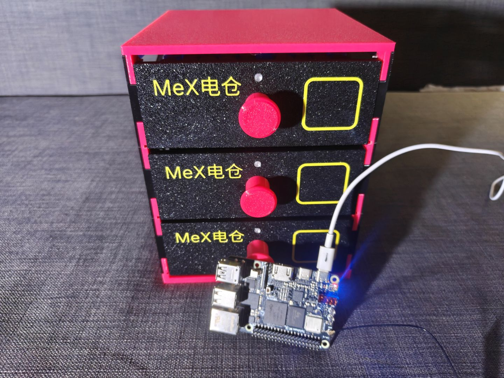
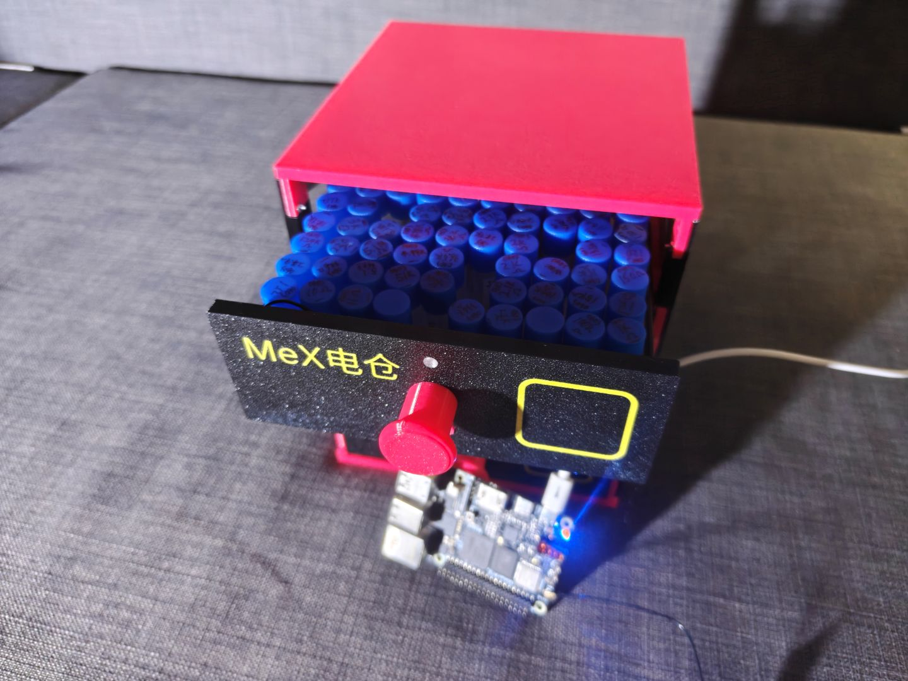
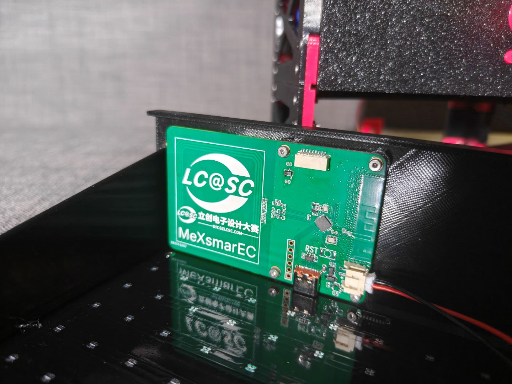

# MeX电仓(MeXsmarEC)

基于 `CH584F芯片 `和`泰山派3M 开发板`的 DIY 电子元件存储管理系统，通过网页管理电子元件库存，自动分配存储位置，支持 NFC 注册和 WS2812 灯光定位。可以方便的扩展到其它类型的存储。

------

## 目录

- 项目简介
- 系统架构
- 硬件需求
- 软件依赖
- 目录结构
- 安装部署
- CH584F固件烧录
- 数据库设计
- API 文档
- 功能说明
- 后续计划

------

## 项目简介

DIY 电子元件存储管理系统用于管理电阻、电容、芯片等电子元件。将物理存储空间划分为三级：

```text
存储库 (warehouse)  —— 一个，物理柜体
  └── 存储箱 (box)   —— 多个，有规格（容量），有放置偏好
        └── 存储盒 (bin) —— 一种元件，对应箱内一个固定格位
```








**核心功能：**

- **存储设备注册**：通过 NFC 标签注册存储库 / 存储箱 / 存储盒
- **自动分配**：添加元件时，根据分类和封装偏好自动选择存储箱和空闲格位
- **多视图查询**：全部 / 按分类 / 按箱子 三种视图查看元件
- **模糊搜索**：按名称、分类、封装、值任意组合查询
- **位置定位**：
  - 通过网页找到元件，然后点「定位」按钮，
  - NFC 扫描 存储盒 上的标签，网页端会跳出对应的详情，存放位置指示 WS2812 也会亮起
- **Web 界面**：Lighttpd + Gunicorn + Flask，浏览器访问
- **无线连接**：所有设备通过蓝牙连接，只需要供电即可

**AI说明：** CH584F程序及泰山派程序均为AI生成，MounRiver Studio Ⅲ的集成AI很好用！


------

## 系统架构


```text
┌─────────────────────────────────────────────┐
│  PC / 手机                          │
│  (浏览器访问 Web 界面)                        │
└──────────────────┬──────────────────────────┘
                   │ HTTP :80
┌──────────────────▼──────────────────────────┐
│  泰山派 开发板                               │
│  ┌──────────────┐    ┌──────────────────┐   │
│  │  Lighttpd    │───▶│  Gunicorn        │   │
│  │  :80 静态文件 │    │  :8000 Flask API │   │
│  └──────────────┘    └────────┬─────────┘   │
│                               │              │
│                      ┌────────▼─────────┐   │
│                      │  SQLite          │   │
│                      │  component.db    │   │
│                      └──────────────────┘   │
│                                              │
│  蓝牙 ────▶ CH584F 从机 ────▶ WS2812     │
└──────────────────────────────────────────────┘
```


- **Lighttpd**：处理静态文件（HTML/CSS/JS），并把 `/api` 请求反向代理到 Gunicorn
- **Gunicorn**：WSGI 服务器，运行 Flask 应用，多 worker 处理并发
- **Flask**：提供 REST API
- **SQLite**：单文件数据库，WAL 模式支持并发读写

------

## 硬件需求

| 设备            | 说明                                                         |
| :-------------- | :----------------------------------------------------------- |
| 泰山派3M 开发板 | 或者其它Linux板子,推荐带 WiFi/BT 模块，至少 256MB 内存       |
| 存储介质        | 建议预留 ≥ 100MB 可写分区用于数据库和日志                    |
| CH584F从机      | 每存储库/箱一颗，CH584F，负责 蓝牙组网，NFC 读取和 WS2812 驱动 |
| NFC 标签        | NTAG213/215/216，贴于存储设备                                |
| 箱子            | 3D打印 M2ｘ10沉头螺丝 M2ｘ6内六角螺丝 M2螺母 M1.4ｘ8螺丝 M1.4螺母 |

------

## 软件依赖

### PC 开发环境

- MounRiver Studio Ⅲ

------

## 目录结构

```text
CH584F/
├── src/
│   ├── Main.c            主流程：时钟 / 串口 / BLE / NFC / 按键 / 状态灯初始化 + 硬件异常现场打印 + TMOS 主循环
│   ├── ble_peripheral.c  从机角色：广播、GATT 服务、Notify 上行、广播门控
│   ├── ble_peripheral.h
│   ├── ble_central.c     主机角色：扫描同网板、建连、服务发现、Write 下行
│   ├── ble_central.h
│   ├── app_mesh.c        网状层：组帧 / 解帧、去重、洪泛转发、LED 处理、上位机在线状态机
│   ├── app_mesh.h
│   ├── app_nfc.c         NFC 轮询读卡（LPCD 检卡 + 防冲突取 UID）+ NDEF 文本读写 + 在场去重
│   ├── app_nfc.h
│   ├── app_key.c         两个按键：PA15 / PB23 低电平触发 + 消抖 + 边沿上报
│   ├── app_key.h
│   ├── app_ind.c         状态指示灯：提示 / 离线报警、闪烁相位同步、广播门控钩子
│   ├── app_ind.h
│   ├── app_led.c         把 0x02 位图指令写到 WS2812 灯带
│   ├── app_led.h
│   ├── ws2812.c          WS2812 驱动（SPI0 + DMA，101 颗灯珠）
│   └── ws2812.h
├── tools/
│   ├── metoo_ble.py      Linux 侧 BLE 客户端示例（bleak）
│   ├── ble_probe.py      Linux 侧连接诊断脚本（服务 / CCCD / Notify 逐项检查）
│   └── metoo_web/        自研上位机（aiohttp + bleak + Web 界面）
├── BLE/
│   ├── LIB/              BLE 协议栈库（libCH58xBLE.a、CH58xBLE_LIB.h、ble_task_scheduler.S）
│   ├── HAL/              HAL 层（MCU.c、RTC.c、SLEEP.c、KEY.c、LED.c、CONFIG.h）
│   └── Profile/          GATT 服务（gattprofile.c/h、devinfoservice.c/h）
├── NFCA/                 NFC-A 读卡器库（libCH58x_NFCA.a、PCD BSP、NTAG21x 驱动）
├── StdPeriphDriver/      外设驱动 + libISP585.a
├── Startup/              startup_CH585.S
├── RVMSIS/               core_riscv.h
├── Ld/Link.ld            链接脚本（FLASH 448K / RAM 96K）
└── obj/                  编译输出
```


```text
webapp/
├── app.py                      Flask 主程序（路由 + API + 数据库访问）
├── init.sql                    数据库初始化脚本
├── component.db                SQLite 数据库文件（运行时生成）
├── start_gunicorn.sh           Gunicorn 启动脚本
├── lighttpd.conf               Lighttpd 配置（静态文件 + 反代）
├── README.md                   本文件
├── templates/                  Jinja2 模板
│   ├── layout.html             公共骨架（顶栏、导航）
│   ├── index.html              概览页
│   ├── components.html         元件列表页（全部 / 分类 / 箱子）
│   ├── component_add.html      添加元件页
│   └── storage.html            存储管理页
└── static/
    ├── css/
    │   └── style.css           全局样式
    └── js/
        ├── common.js           通用工具（api / escapeHtml / notify / loadStats）
        ├── index.js            概览页逻辑
        ├── components.js       元件列表页逻辑
        ├── component_add.js    添加元件页逻辑
        └── storage.js          存储管理页逻辑
```


------

## 安装部署

### 1. 部署文件到开发板

板子上解压：

```bash
cd /MeXsmarEC
tar xvf webapp.tar
```

### 2. 设置可执行权限

```bash
python3 -m venv .venv
source .venv/bin/activate
pip install -r requirements.txt
```


### 3. 启动服务

**方式 A：手动启动（调试用）**

```bash
pthon3 app.py

```

### 4. 访问

浏览器打开：

```text
http://<板子IP>:5000/
```


------

## CH584F固件烧录

断电后，按住B键上电，使用WCHISPStudio下载

------

## 数据库设计

### 表结构

#### `warehouse` — 存储库

| 字段      | 类型        | 说明                          |
| :-------- | :---------- | :---------------------------- |
| id        | INTEGER PK  | 自增主键                      |
| name      | TEXT        | 库名                          |
| nfc_uid   | TEXT UNIQUE | NFC 标签 UID                  |
| ble_mac   | TEXT        | 对应 CH584F的蓝牙 MAC         |
| led_index | INTEGER     | 该库在 CH584F上的 WS2812 序号 |
| note      | TEXT        | 备注                          |

#### `box_spec` — 箱规格

| 字段     | 类型        | 说明                      |
| :------- | :---------- | :------------------------ |
| id       | INTEGER PK  | 自增主键                  |
| name     | TEXT UNIQUE | 规格名，如「100格标准箱」 |
| capacity | INTEGER     | 容量（格位数）            |
| note     | TEXT        | 备注                      |

预置规格：100 格标准箱 / 50 格小箱 / 200 格大箱。

#### `box` — 存储箱

| 字段          | 类型        | 说明                          |
| :------------ | :---------- | :---------------------------- |
| id            | INTEGER PK  | 自增主键                      |
| warehouse_id  | INTEGER FK  | 所属存储库                    |
| spec_id       | INTEGER FK  | 规格                          |
| name          | TEXT        | 箱名                          |
| nfc_uid       | TEXT UNIQUE | NFC 标签 UID                  |
| ble_mac       | TEXT        | 对应 CH584F的蓝牙 MAC         |
| led_index     | INTEGER     | 该箱在 CH584F上的 WS2812 序号 |
| pref_category | TEXT        | 优先放置的分类，如「电阻」    |
| pref_package  | TEXT        | 优先放置的封装，如「0603」    |
| note          | TEXT        | 备注                          |

#### `bin` — 存储盒（= 一种元件）

| 字段       | 类型        | 说明                    |
| :--------- | :---------- | :---------------------- |
| id         | INTEGER PK  | 自增主键                |
| box_id     | INTEGER FK  | 所属存储箱              |
| slot_index | INTEGER     | 箱内格位（0 起）        |
| name       | TEXT        | 元件名，如「10kΩ 电阻」 |
| category   | TEXT        | 分类                    |
| package    | TEXT        | 封装                    |
| value      | TEXT        | 值                      |
| quantity   | INTEGER     | 数量                    |
| nfc_uid    | TEXT UNIQUE | NFC 标签 UID            |
| led_index  | INTEGER     | 该盒的 WS2812 序号      |
| note       | TEXT        | 备注                    |
| created_at | DATETIME    | 创建时间                |

唯一约束：`(box_id, slot_index)`。

### 自动分配算法

添加元件时，系统按以下优先级选择存储箱：

| 优先级 | 条件                                              | 分数 |
| :----- | :------------------------------------------------ | :--- |
| 1      | 分类和封装都匹配 `pref_category` / `pref_package` | 3    |
| 2      | 只匹配 `pref_category`                            | 2    |
| 3      | 只匹配 `pref_package`                             | 1    |
| 4      | 未设偏好（都为 NULL）                             | 0    |

同分数时，选择**已用格位最少**的箱，让填充均匀。找到箱后，选择**最小的空闲 `slot_index`**作为格位。

如果所有箱都满，返回 409 错误。也支持手动指定 `box_id`，此时跳过自动分配。

------

## API 文档

所有接口返回 JSON。错误时返回 `{"error": "..."}` 和对应的 HTTP 状态码。

### 页面路由

| 方法 | 路径              | 说明       |
| :--- | :---------------- | :--------- |
| GET  | `/`               | 概览页     |
| GET  | `/components`     | 元件列表页 |
| GET  | `/components/add` | 添加元件页 |
| GET  | `/storage`        | 存储管理页 |

### 元数据

| 方法 | 路径                   | 说明                 |
| :--- | :--------------------- | :------------------- |
| GET  | `/api/meta/categories` | 返回常见元件分类列表 |
| GET  | `/api/meta/packages`   | 返回常见封装列表     |

### 存储库

| 方法   | 路径                   | 说明                       |
| :----- | :--------------------- | :------------------------- |
| GET    | `/api/warehouses`      | 列表                       |
| POST   | `/api/warehouses`      | 添加                       |
| PUT    | `/api/warehouses/<id>` | 修改                       |
| DELETE | `/api/warehouses/<id>` | 删除（级联删除其下箱和盒） |

**POST 请求体：**


```json
{
  "name": "一号元件库",
  "nfc_uid": "NFC-WH-01",
  "ble_mac": "AA:BB:CC:DD:EE:01",
  "led_index": 0,
  "note": ""
}
```


### 箱规格

| 方法   | 路径                  | 说明                   |
| :----- | :-------------------- | :--------------------- |
| GET    | `/api/box-specs`      | 列表                   |
| POST   | `/api/box-specs`      | 添加                   |
| PUT    | `/api/box-specs/<id>` | 修改                   |
| DELETE | `/api/box-specs/<id>` | 删除（有箱使用则拒绝） |

**POST 请求体：**


```json
{
  "name": "100格标准箱",
  "capacity": 100,
  "note": "适合一般元件"
}
```

### 存储箱

| 方法   | 路径              | 说明                         |
| :----- | :---------------- | :--------------------------- |
| GET    | `/api/boxes`      | 列表，支持 `?warehouse_id=N` |
| POST   | `/api/boxes`      | 添加                         |
| PUT    | `/api/boxes/<id>` | 修改（含偏好、BLE、LED）     |
| DELETE | `/api/boxes/<id>` | 删除（连带删除箱内所有盒）   |

**POST 请求体：**

```json
{
  "warehouse_id": 1,
  "spec_id": 1,
  "name": "电阻箱A",
  "pref_category": "电阻",
  "pref_package": "0603",
  "ble_mac": "AA:BB:CC:DD:EE:01",
  "led_index": 1,
  "nfc_uid": "NFC-BOX-01"
}
```

### 存储盒

| 方法   | 路径             | 说明                                         |
| :----- | :--------------- | :------------------------------------------- |
| GET    | `/api/bins`      | 列表，支持 `?box_id=N`                       |
| PUT    | `/api/bins/<id>` | 修改（名称、分类、封装、值、数量、NFC、LED） |
| DELETE | `/api/bins/<id>` | 删除                                         |

### 元件（= 存储盒）

| 方法 | 路径                          | 说明                         |
| :--- | :---------------------------- | :--------------------------- |
| GET  | `/api/components`             | 搜索 / 筛选                  |
| POST | `/api/components`             | 添加元件（自动分配箱和格位） |
| POST | `/api/components/<id>/locate` | 定位，返回三级亮灯路径       |

**GET `/api/components` 查询参数：**

| 参数       | 说明                                      |
| :--------- | :---------------------------------------- |
| `q`        | 模糊搜索，匹配名称 / 值 / 封装 / 分类     |
| `category` | 按分类精确筛选，特殊值 `未分类` 匹配 NULL |
| `box_id`   | 按箱子精确筛选                            |

可以组合使用，如 `?category=电阻&q=10k`。

**POST `/api/components` 请求体：**

```json
{
  "name": "10kΩ 电阻",
  "category": "电阻",
  "package": "0603",
  "value": "10kΩ",
  "quantity": 100,
  "nfc_uid": null,
  "note": "",
  "box_id": null
}
```

`box_id` 省略或为 null 时自动分配；指定时直接使用该箱。

**响应：**

```json
{
  "id": 5,
  "box_id": 1,
  "slot_index": 3,
  "status": "created"
}
```


**定位响应：**

```json
{
  "bin": { "...": "..." },
  "lights": [
    { "ble_mac": "AA:BB:CC:DD:EE:01", "led_index": 0, "level": "warehouse", "name": "一号元件库" },
    { "ble_mac": "AA:BB:CC:DD:EE:01", "led_index": 1, "level": "box",       "name": "电阻箱A" },
    { "ble_mac": "AA:BB:CC:DD:EE:01", "led_index": 3, "level": "bin",       "name": "10kΩ 电阻" }
  ]
}
```


### 统计与树

| 方法 | 路径                               | 说明                             |
| :--- | :--------------------------------- | :------------------------------- |
| GET  | `/api/storage/tree`                | 库 → 箱 → 盒 完整树              |
| GET  | `/api/storage/stats`               | 库 / 箱 / 盒 / 规格 / 总容量统计 |
| GET  | `/api/components/categories/stats` | 每个分类的元件数和总数量         |
| GET  | `/api/components/recent?limit=10`  | 最近添加的元件                   |

------

## 功能说明

### 存储管理

- **存储库**：一个系统通常只有一个。可设置 BLE MAC 和 LED 序号，用于后续蓝牙通信。
- **箱规格**：可自定义任意规格。修改容量时如果已有箱超过新容量会拒绝。删除时如果还有箱在用也会拒绝。
- **存储箱**：
  - 必须属于某个存储库，且选择一个规格
  - 可设置 `pref_category` 和 `pref_package`，影响自动分配
  - 可设置 BLE MAC 和 LED 序号
  - 删除时连带删除箱内所有存储盒

### 添加元件

添加元件等价于在某个存储箱中放入一个新的存储盒。

**自动分配流程：**

1. 系统根据用户填写的 `category` 和 `package`
2. 在所有未满的存储箱中，按「匹配分数 + 已用格位数」排序
3. 选出最优的箱，分配最小的空闲格位
4. 如果用户手动指定了 `box_id`，直接使用该箱

**分类与封装：**

- 分类和封装来自 `app.py` 中的 `CATEGORIES` 和 `PACKAGES` 常量
- 前端用 `<datalist>` 提供下拉建议
- 用户也可以手动输入列表里没有的值，不会被拒绝
- 增加新分类只需修改 `app.py` 中的列表，重启服务即可

### 元件列表

三种视图共用顶部的搜索框，搜索会叠加在筛选结果上。

- **全部**：所有元件，表格展示
- **按分类**：下拉选择分类，只显示该分类
- **按箱子**：下拉选择箱子，只显示该箱子

每行操作：

- **定位**：调用 `/api/components/<id>/locate`，返回三级位置。后续接蓝牙后会自动点亮 WS2812。
- **改数量**：修改 `quantity` 字段
- **删除**：删除该存储盒

### 概览

- 顶部统计栏：库 / 箱 / 盒 / 规格数量
- 存储概览卡片
- 分类统计横向柱状图
- 最近添加的 10 个元件

------

## 后续计划

- □ 

  **MeXcon3M**：使用泰山派3M3M制作掌上终端,提供图形界面

- □ 

  **定位动画**：后端计算亮灯序列后，按三级顺序依次点亮（库 → 箱 → 盒），用不同颜色区分

- □ 

  **数据导出**：支持导出 CSV / JSON 备份元件库

- □ 

  **图片支持**：为元件关联照片

- □ 

  **批量导入**：从立创商城批量导入元件

- □ 

  **用户认证**：多用户或密码保护
